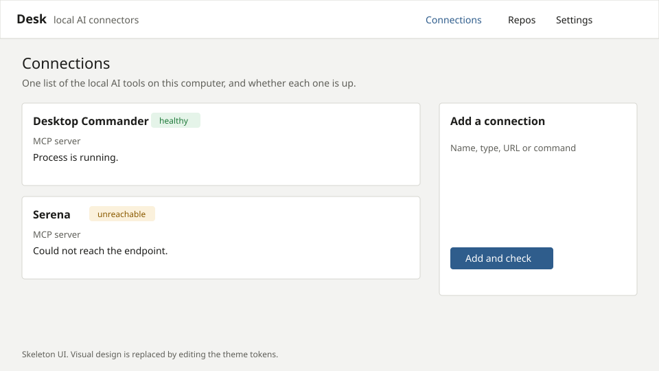
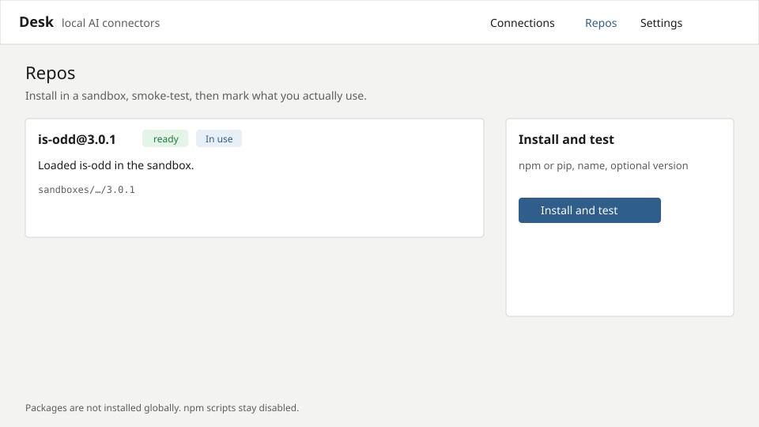
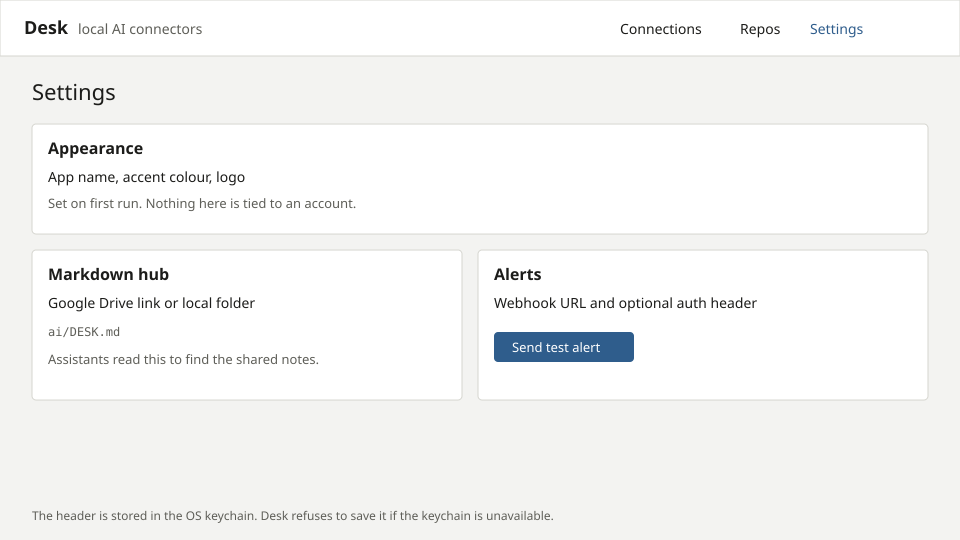
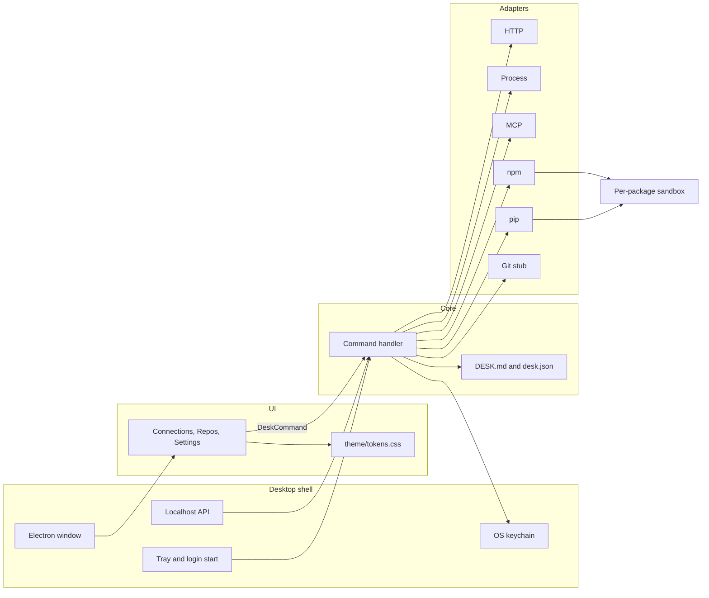

# Desk

[](https://github.com/LotusmirkAerospace/lotusmirk-desk/actions/workflows/ci.yml)
[](LICENSE)

Desk is a free desktop app for the AI tools already running on your computer. It is the one place to see them, connect them, and check that they are up, so every assistant you use has the same local setup.

Point it at Desktop Commander, Serena, or any other MCP server. Add an HTTP endpoint or a local process. Desk keeps the list, checks it, and can tell your own bot when something fails. It also records where your shared markdown lives, and it can install an open-source package into a sandbox, smoke-test it, and remember whether you actually use it.

Built by [Lotusmirk](https://lotusmirk.com).

The first run asks for a name, an accent colour, and an optional logo. Those stay on that computer. The app is not tied to an account, and it does not need a cloud service.

## Interface

The window below is the current skeleton. Colours and type live in [`src/renderer/src/theme/tokens.css`](src/renderer/src/theme/tokens.css), so the layout can be restyled without touching the checks, the registry, or the shell.







## Features

- **Connectors.** HTTP checks, process checks, and a generic MCP check (HTTP or stdio). Reconnect starts a process again. Failures are logged, and the same failure is not repeated until the connector recovers.
- **Your name and mark.** First-run setup sets the app name, accent colour, and logo. Change them later in Settings.
- **Markdown hub.** Paste a Google Drive folder link or a local folder path. Desk writes `DESK.md` and `desk.json` so other assistants know where those notes live and which connectors are configured. Credentials are not copied into that file.
- **Alerts.** A webhook URL, plus an optional authorization header kept in the OS keychain. Desk POSTs when a connector fails. **Send test alert** checks the webhook immediately.
- **Repos.** npm and pip packages install into their own sandbox, with npm scripts left disabled. A smoke test loads the module. The registry records ready, failed, and in use, and can uninstall or roll back to the last version that passed.
- **Tray.** Closing the window leaves Desk running. Quit is on the tray menu. Starting at login is optional.
- **Local API and inbox.** Another program on this machine can POST a package, or drop JSON into the inbox folder.

## Install

You need Node.js 22 or newer to build from source. Packaged installers are produced with electron-builder.

### From source (Windows, macOS, and Linux)

```bash
git clone https://github.com/LotusmirkAerospace/lotusmirk-desk.git
cd lotusmirk-desk
npm install
npm run dev
```

`npm run dev` opens the window and serves the same UI at [http://127.0.0.1:47331](http://127.0.0.1:47331). The window uses a preload bridge. A browser tab uses the localhost API on port 47332. Both call the same commands.

### Packaged apps

```bash
npm run dist:win     # NSIS installer
npm run dist:mac     # DMG
npm run dist:linux   # AppImage and deb
```

Code signing and auto-update are not in 0.1.0. On Linux, login start writes an XDG autostart file. Windows and macOS use the system login item.

Data is stored in the OS app-data folder for Desk. Settings shows the exact path. A typical Linux path is `~/.config/Desk`.

## Quick start

1. Start Desk and set the name, colour, and logo you want on this computer. One button finishes setup.
2. Add a connector. For an MCP server, choose MCP, then HTTP or stdio, and check it.
3. Optional: in Settings, paste the Google Drive folder link or local path for shared markdown. Assistants can read `ai/DESK.md` inside the data folder.
4. Optional: add your bot's webhook and send a test alert.
5. Optional: on Repos, install a package and mark it in use after the smoke test passes. **Try sample: npm is-odd** is there if you want a known-good package.

An inbox file looks like this:

```json
{ "sourceId": "npm", "locator": "is-odd", "version": "3.0.1" }
```

The same action over HTTP:

```bash
curl -s -X POST http://127.0.0.1:47332/api/command \
  -H 'content-type: application/json' \
  -d '{"type":"addAndInstall","sourceId":"npm","locator":"is-odd","version":"3.0.1"}'
```

If port 47332 was taken, the live port is in `api-port.json` in the data folder.

## Architecture



| Path | Role |
| --- | --- |
| `src/core` | Registry, onboarding, markdown instructions, webhooks, inbox. No Electron imports. |
| `src/adapters` | Connector and package-source plugins. |
| `src/shared` | Commands and snapshots used by the UI and the core. |
| `src/renderer` | Screens. Restyle `theme/tokens.css`. |
| `src/main` | Window, tray, login start, keychain, localhost API. |
| `src/preload` | The only bridge the window is given. |

The renderer does not import the core. A test locks that boundary.

### Add a connector

Implement `ConnectionAdapter`, then register it in `src/adapters/connection/index.ts`.

```ts
import type { ConnectionAdapter } from '../types';

export const exampleAdapter: ConnectionAdapter = {
  id: 'example',
  label: 'Example',
  description: 'What this check is for.',
  implemented: true,
  fields: [{ key: 'url', label: 'URL', required: true, input: 'text' }],
  validate(config) {
    if (!config.url) throw new Error('URL is required.');
  },
  async check(record, ctx) {
    const started = ctx.clock().getTime();
    return {
      status: 'healthy',
      checkedAt: ctx.clock().toISOString(),
      latencyMs: ctx.clock().getTime() - started,
      message: `Checked ${record.config.url}.`,
    };
  },
};
```

Return `unreachable` or `error` when the tool is down. Put secrets on the optional `secret` field. Desk stores them through the keychain and does not write them into `connections.json` or `DESK.md`.

Built in today:

- `http` — GET a URL. 2xx is healthy.
- `process` — program is on PATH, or its process is running. Reconnect spawns it.
- `mcp` — HTTP reachability (any status below 500), or a stdio process.

### Add a package source

Implement `RepoSourceAdapter` and register it in `src/adapters/repo/index.ts`. `install` may write only inside `request.sandboxDir`. `smoke` reports whether the package loads. Set `implemented: false` to show a source that is not ready. Git is that stub.

## Stack

Desk is an [Electron](https://www.electronjs.org/) app. The interface is React and TypeScript, built with [electron-vite](https://electron-vite.org/). The checks and the registry are plain TypeScript, tested with Vitest. Installers come from [electron-builder](https://www.electron.build/).

Electron fits this project better than a Rust shell:

- A new connector is a TypeScript module. Contributors do not need a second language.
- The same modules run in unit tests and in the app.
- `safeStorage` uses the OS credential store (Windows DPAPI, macOS Keychain, Linux libsecret) without a native add-on. If that service is not running, Desk says so and refuses to save the secret.
- Windows and macOS login items use Electron. Linux login uses an XDG autostart file, because current Electron does not implement login items there.

The tradeoff is download size. Electron ships its own Chromium.

## Tests

```bash
npm run lint
npm test
npm run typecheck
```

GitHub Actions runs those three on every push and pull request. `npm test` covers connector checks, sandbox install commands, rollback, the inbox, branding, the markdown hub, webhook alerts, and the UI boundary. The optional live install is `DESK_LIVE=1 npm run test:live`.

## Roadmap

- **Repo Hunt library.** A place to collect candidate open-source repos before anyone installs them, including notes on why they were found.
- **Repo Manager.** Richer installs than a single npm or pip package: keep the sandbox, the smoke result, and what is actually in use, and roll a bad upgrade back.
- **More connectors.** A real MCP initialize handshake, more local AI tools, and a git source that clones into a sandbox and runs a smoke command you choose.
- Optional install scripts, off unless you turn them on.
- "In use" writing into a local tool config you pick.
- Signed installers and an update channel.

## Contributing

See [CONTRIBUTING.md](CONTRIBUTING.md). Please also read the [code of conduct](CODE_OF_CONDUCT.md). Security reports go through [private advisories](https://github.com/LotusmirkAerospace/lotusmirk-desk/security/advisories/new), described in [SECURITY.md](SECURITY.md).

## License

[MIT](LICENSE). Copyright 2026 Desk contributors.
